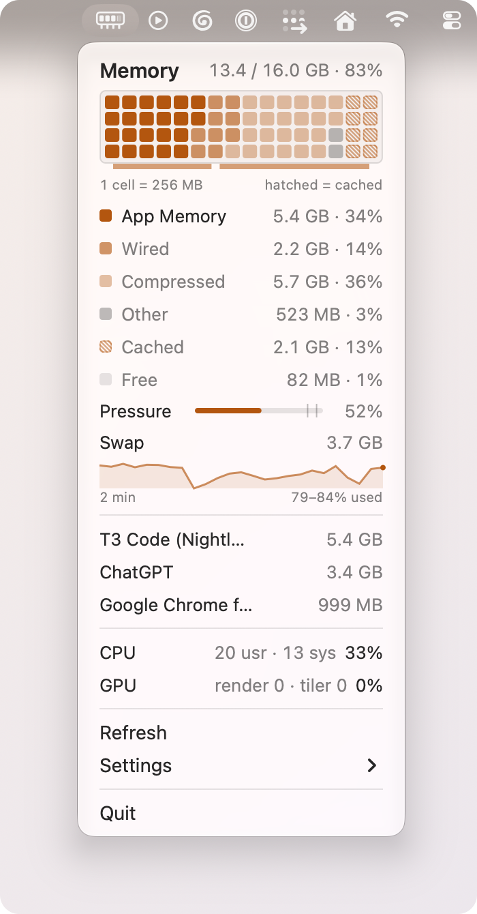

  

<h1 align="center">rami</h1>

<b>A restrained system monitor that lives in your Mac menu bar.</b>

  
  
  

  <picture>
    <source media="(prefers-color-scheme: dark)" srcset="assets/readme-dark.png">
    <source media="(prefers-color-scheme: light)" srcset="assets/readme-light.png">
    
  </picture>

One memory gauge stays in the menu bar. Click it to see Memory, CPU, and GPU
in one compact native menu: a memory map with its breakdown and pressure, a
bounded history, the apps using the most memory, and one-line CPU and GPU
readings (GPU when macOS exposes it). A small trend marker appears when memory is
climbing fast.

CPU, GPU, and app rows can each be hidden. There is still one status item, no
dock icon, and no window.

Settings also includes auto-refresh, launch-at-login status, and a local
diagnostics copy action.

## Install

rami needs an Apple Silicon Mac with macOS 14 or later.

1. Download `rami-<version>.dmg` from the
   [latest release](https://github.com/proxynico/rami/releases/latest).
2. Open it and drag rami into Applications.
3. Open rami. It is not notarized by Apple, so macOS blocks the first launch.
   Close the warning, then open System Settings → Privacy & Security, click
   Open Anyway, confirm, and enter your Mac's password.

Repeat step 3 after each update.

To build it yourself, see [BUILDING.md](BUILDING.md).

## License

[MIT](LICENSE).
